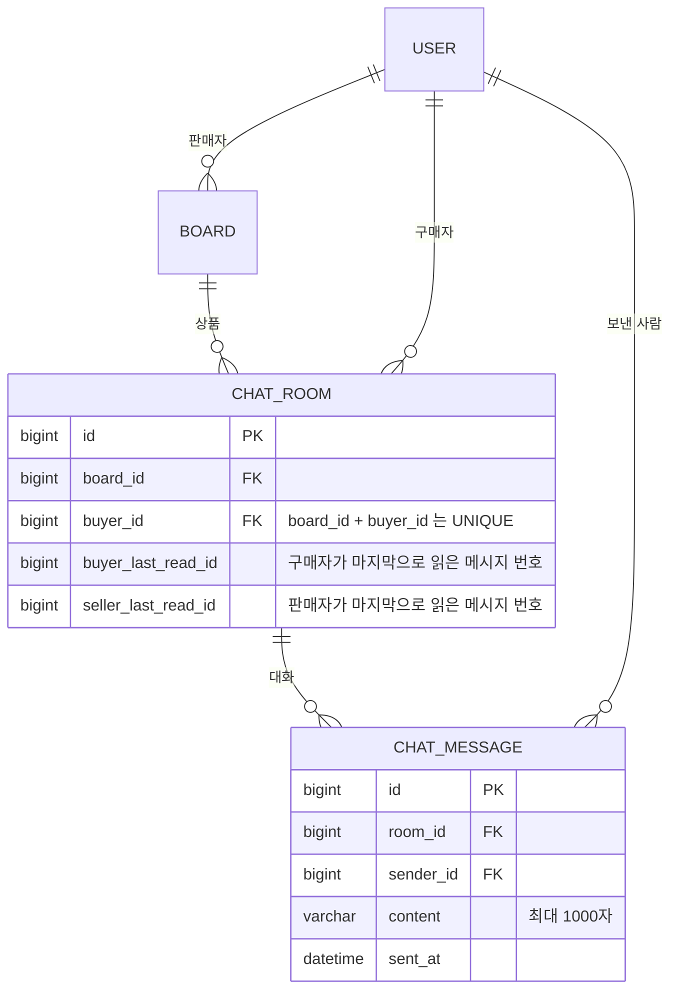
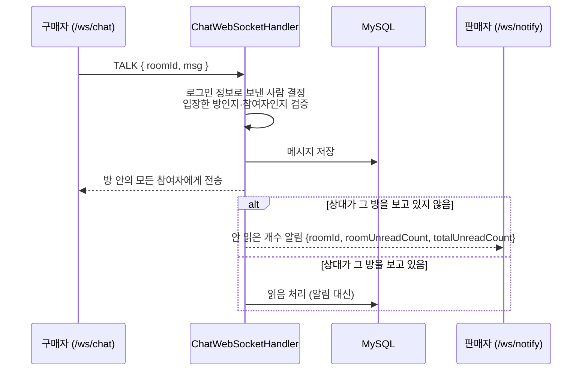

# Yours & Mine — 중고거래 웹 서비스

판매자가 상품을 올리면 구매자가 **채팅으로 협의**한 뒤 거래하는 중고거래 웹 서비스입니다.
Java / Spring Boot 기반이며, 특히 **실시간 채팅(WebSocket)** 을 안전하고 확장 가능한 구조로 다듬는 데 집중했습니다.

- 2인 팀 프로젝트: 회원·상품·거래 상태는 함께 구현했고, **채팅은 단독으로 구현**했습니다.
- 이후 채팅 영역을 대상으로 보안·동시성·영속성 문제를 찾아 개선했습니다. ([문제 해결 기록](#문제-해결-기록) 참고)

> 개선 작업은 AI 코딩 도구(Claude Code)와 함께 진행했습니다. 각 단계의 문제, 원인, 설계 이유, 테스트를 아래에 정리했습니다.

---

## 주요 기능

| 영역 | 기능 |
|---|---|
| 회원 | 회원가입, 로그인/로그아웃 (Spring Security, BCrypt), 일반/관리자 권한 |
| 상품 | 등록(이미지 업로드)·수정·삭제, 검색, 페이징 목록, 상세 |
| 거래 | 판매중 / 판매완료 상태 변경 (판매자), 찜하기, 마이페이지, 찜목록 |
| **채팅** | 상품 상세의 **연락하기** → (상품, 구매자) 단위 1:1 채팅방, 실시간 메시지, **대화 DB 저장**, **안 읽은 메시지 배지(실시간)**, **이전 대화 페이징** |
| 관리자 | 상품 강제 삭제 |

거래 흐름은 "채팅으로 협의 → 판매자가 구매자를 고르고 거래 → 판매자가 판매완료 처리"입니다.
따라서 동시에 여러 구매자가 같은 상품을 예약하는 구조가 아닙니다.

## 기술 스택

- **Backend**: Java 17, Spring Boot 3.3, Spring MVC, Spring Data JPA, MyBatis, Spring Security, Spring WebSocket
- **View**: Thymeleaf, Bootstrap, 바닐라 JavaScript
- **DB**: MySQL 8 (개발은 Docker 컨테이너)
- **Test**: JUnit 5, Spring Boot Test (실제 서버를 띄우는 WebSocket 통합 테스트 포함)
- **Build**: Maven (Maven Wrapper)

---

## 채팅 구조

### 데이터



- 채팅방은 **(상품, 구매자) 한 쌍당 하나**입니다. 판매자는 상품(`board.user`)에서 알 수 있어서 따로 저장하지 않습니다.
- 상품을 삭제하면 채팅방과 대화도 함께 삭제됩니다 (cascade).

### 메시지가 흐르는 경로



### 엔드포인트

| 종류 | 경로 | 설명 |
|---|---|---|
| 화면 | `GET /chat/chatList` | 내가 구매자/판매자인 방 목록 (방별 안 읽은 개수) |
| 화면 | `POST /chat/start` | 연락하기: (상품, 나) 방을 만들거나 기존 방으로 이동 |
| 화면 | `GET /chat/room/{id}` | 채팅방 (최근 30개). 참여자만, 열면 읽음 처리 |
| API | `GET /chat/room/{id}/messages?before={messageId}` | 그 번호보다 오래된 대화 30개 (JSON) |
| API | `GET /chat/unread` | 내 전체 안 읽은 개수 (메뉴 배지) |
| WebSocket | `/ws/chat` | 채팅 (ENTER / TALK / QUIT) |
| WebSocket | `/ws/notify` | 안 읽은 개수 알림 (서버 → 클라이언트) |

---

## 문제 해결 기록

처음 구현한 채팅은 동작은 했지만, 코드를 다시 읽어보니 아래 문제들이 있었습니다.
각 항목은 **문제 → 원인 → 해결 → 검증** 순서입니다.

### 1. 채팅방이 여러 개면 다른 사람의 대화가 보였다
- **원인**: 실제로 연결된 핸들러가 방 구분 없이 접속한 모든 세션에 메시지를 그대로 보내는 구조였습니다. 방별로 세션을 나누는 핸들러는 만들어져 있었지만 어디에도 등록되지 않았습니다. 또 `sender`를 클라이언트가 보낸 값 그대로 믿었습니다.
- **해결**: 방 단위 핸들러 하나로 정리하고, 방에 입장(ENTER)할 때와 메시지를 보낼 때 **서버에서 참여자 여부를 검증**합니다. 보낸 사람은 클라이언트 값이 아니라 **로그인 정보(`session.getPrincipal()`)** 로 정합니다. 입장하지 않은 방으로는 보낼 수 없습니다.
- **검증**: 통합 테스트로 확인했습니다. 비참여자 입장 시 연결이 끊김(1008), 클라이언트가 `sender`를 `hacker`로 속여도 실제 보낸 사람으로 기록됨, 입장하지 않은 방으로 보낸 메시지는 저장되지 않음.

### 2. 서버를 재시작하면 방과 대화가 사라졌다
- **원인**: 방 목록이 `Map`에만 있었고, 메시지는 DB에 저장하지 않았습니다.
- **해결**: `ChatRoom`, `ChatMessage`를 JPA 엔티티로 만들어 DB에 저장하고, 방에 들어올 때 이전 대화를 불러옵니다.

### 3. 방이 상품·판매자와 연결되어 있지 않았다
- **원인**: 방이 이름만 가진 상자였고 전체 목록을 모두가 봤습니다. 판매자는 자기 상품에 온 방을 찾을 수 없었습니다.
- **해결**: 방을 **(상품, 구매자) 단위**로 만들고 `UNIQUE(board_id, buyer_id)` 제약을 뒀습니다. 목록에는 내가 참여한 방만 보입니다. 같은 구매자가 연락하기를 두 번 눌러도 기존 방을 씁니다.
- **동시성**: 두 요청이 동시에 같은 방을 만들면 unique 제약에 걸립니다. 하나의 트랜잭션 안에서는 예외 뒤에 조회를 이어갈 수 없어서, 일부러 트랜잭션을 걸지 않고 **예외를 잡은 뒤 먼저 만들어진 방을 다시 조회**합니다.

### 4. 동시 접속에 안전하지 않았다
- **원인**: 세션 목록으로 `ArrayList`/`HashSet`을 여러 스레드가 함께 썼고, 한 세션 전송이 실패하면(`parallelStream`) 전체가 중단됐습니다. 탭을 그냥 닫아도 닫힌 세션이 방에 남았습니다. 존재하지 않는 방 번호가 오면 NPE가 났습니다.
- **해결**: `ConcurrentHashMap`으로 바꾸고, 같은 세션에 동시에 `sendMessage` 하지 않도록 `ConcurrentWebSocketSessionDecorator`로 감쌌습니다. 전송은 세션마다 try/catch로 분리해 한 명의 실패가 다른 사람에게 영향을 주지 않게 했고, 연결이 끊기면(`afterConnectionClosed`) 방에서 제거합니다.

### 5. 상대가 오프라인일 때 새 메시지를 알 수 없었다 (안 읽은 메시지)
- **해결**: 방마다 구매자/판매자 각각의 **"마지막으로 읽은 메시지 번호"** 를 저장하고, 안 읽은 개수는 *내가 보내지 않았고 읽은 번호보다 큰 메시지*의 수로 계산합니다. 읽음 처리는 (a) 방 화면을 열 때 (b) 상대가 그 방을 보고 있는 중에 메시지가 올 때 합니다.
- **동시성**: 읽은 번호는 앞으로만 가야 합니다. 순서가 뒤바뀐 요청이 와도 이미 읽은 메시지가 안 읽음으로 되돌아가지 않도록, 조건을 `UPDATE ... WHERE 읽은번호 < 새번호` 문 안에 넣어 **DB가 원자적으로** 판단하게 했습니다.

### 6. 목록 화면에서는 새로고침해야 새 메시지가 보였다
- **원인**: 소켓이 채팅방 화면에만 있어서, 목록 화면은 열었을 때 한 번만 DB를 읽었습니다.
- **해결**: **알림 전용 소켓 `/ws/notify`** 를 추가해 로그인한 모든 화면이 연결합니다. 안 읽은 개수가 바뀔 때(새 메시지, 읽음 처리) 서버가 현재 개수를 밀어줍니다. 메뉴의 "채팅" 배지와 목록의 방별 배지가 실시간으로 바뀌고, 다른 탭에서 읽으면 이 탭의 배지도 줄어듭니다. 연결이 끊기면 지수 백오프로 재연결합니다.

### 7. 대화가 많아지면 방에 들어올 때마다 전체를 불러왔다
- **해결**: 최근 30개만 불러오고, 위로 스크롤하면 이전 30개를 더 불러오는 **커서 기반 페이징**으로 바꿨습니다.
  - "몇 번째 페이지"가 아니라 "이 메시지 번호보다 앞"으로 자릅니다. 이전 대화를 불러오는 사이 새 메시지가 와도 결과가 밀리지 않습니다.
  - 31개를 조회해 31번째가 있으면 더 있다고 판단합니다. 별도의 `count` 쿼리가 필요 없습니다.
  - 위에 끼워 넣어도 보던 위치가 유지되도록 스크롤을 보정합니다.

### 8. 그 밖에 찾아서 고친 것
- **로그인 없이 열려 있던 `/api/**` 정리**: 튜토리얼에서 가져온 CRUD가 인증 없이 노출되어 있어서, 누구나 **전체 회원 목록(비밀번호 해시 포함)을 조회**하고 **남의 상품·계정을 삭제**할 수 있었습니다. 테스트 계정으로 로그인 없이 직접 호출해서 확인했습니다. 쓰지 않는 API는 제거하고, 가입 화면의 아이디 중복 확인만 열어두었으며, 상품 삭제는 **소유자만**(관리자는 별도 경로) 가능하게 했습니다. 설정이 실수로 다시 열리면 실패하는 테스트와, 로그인 없음 / 다른 사용자 / 소유자 / 관리자별 통합 테스트로 확인했습니다.
- **상품 수정·판매 상태 변경의 권한 검사 누락**: 로그인만 하면 남의 상품의 내용과 소유자를 바꾸거나, 남의 판매 상태를 바꾸거나, 폼의 사진 번호(`Fid`)를 조작해 **남의 사진 정보를 덮어쓸 수** 있었습니다. 먼저 공격을 재현하는 테스트를 작성해 실패하는 것을 확인한 뒤(수정 전 9개 중 6개 실패) 고쳤습니다. 수정은 소유자만 가능하고, 판매 상태는 0/1만 허용하며, 클라이언트가 보낸 사진 번호는 "이 상품의 사진"일 때만 인정합니다. 권한 검사는 업로드 파일을 쓰기 **전에** 해서, 거부된 요청이 파일을 남기지 않습니다.
- `setAllowedOrigins("*")` 제거: 기본값(같은 출처만 허용)으로 두어, 다른 사이트가 로그인된 사용자의 쿠키로 소켓에 접속하는 것을 막았습니다.
- 클라이언트는 메시지 내용을 `msg`로, 서버는 `message`로 주고받아 입장·퇴장 알림이 `undefined`로 보이던 필드 이름 불일치를 맞췄습니다.
- `ws://localhost:8080` 하드코딩을 현재 접속 주소 기반으로 변경했습니다.
- 한글 입력 중 Enter에서 마지막 글자가 두 번 전송되던 문제를 `isComposing` 검사로 막았습니다.
- 업로드 폴더가 없으면 상품 등록이 실패하던 문제를 폴더 자동 생성으로 고쳤습니다.

---

## 테스트

```bash
./mvnw test
```

MySQL이 떠 있어야 합니다. ([실행 방법](#실행-방법)의 1번 참고)

| 종류 | 내용 |
|---|---|
| 서비스 테스트 | 같은 (상품, 구매자)는 같은 방, 본인 상품에는 채팅 불가, 참여자만 조회·전송, 안 읽은 개수 계산, 읽은 번호가 뒤로 가지 않음, 페이징 경계(정확히 30개 / 31개 / 없음), 새 메시지가 와도 페이지가 밀리지 않음 |
| API 접근 제어 테스트 | 로그인 없이 `/api/**` 접근 시 로그인 화면으로 이동(설정 자체를 잠금), 남의 상품 삭제 403, 소유자 삭제 성공, 관리자 전용 경로, 가입 화면의 아이디 중복 확인만 로그인 없이 허용 |
| 상품 권한 테스트 | 남의 상품 수정·판매 상태 변경·수정 화면 거부(403), 존재하지 않는 상품 404, 판매 상태 값 검증, 남의 사진 번호 조작 무시, 거부된 요청이 업로드 파일을 남기지 않음. 소유자의 등록·수정·상태 변경은 정상 동작 |
| WebSocket 통합 테스트 | **실제 서버를 띄워** 로그인 → 세션 쿠키로 소켓 접속. 로그인 없는 접속 거부, 다른 출처 거부, 비참여자 입장 거부, `sender` 위조 무시, 알림 전달, 화면 렌더링, 상품 삭제 시 cascade |

테스트가 규칙을 실제로 지키는지 확인하기 위해, 규칙을 **일부러 깨뜨려 테스트가 실패하는지** 점검했습니다. 예를 들어 참여자 검증을 끄거나, 출처 제한을 풀거나, 커서 조건을 `<=`로 바꾸면 해당 테스트가 실패합니다.

---

## 실행 방법

필요한 것: **JDK 17**, **Docker**

**1. MySQL 실행** (설정 파일의 DB 이름·계정과 같은 값으로 맞춘 로컬 개발용 컨테이너)

```bash
docker run -d --name mymarket-mysql -p 3306:3306 -e MYSQL_ROOT_PASSWORD=root -e MYSQL_DATABASE=mymarketdb -e MYSQL_USER=myadmin -e MYSQL_PASSWORD=market mysql:8.0
```

다음부터는 `docker start mymarket-mysql`로 다시 켭니다.

**2. 앱 실행**: IntelliJ에서 `MarketApplication`을 실행하고 http://localhost:8080 으로 접속합니다.

- 첫 실행 때 테이블이 자동 생성(`ddl-auto=update`)되고, `data.sql`이 기본 권한(`ROLE_USER`, `ROLE_ADMIN`)을 넣습니다.
- DB 계정은 환경 변수 `DB_USERNAME`, `DB_PASSWORD`로 바꿀 수 있습니다. 없으면 위 Docker 컨테이너용 기본값을 씁니다.
- 가입한 사용자는 모두 `ROLE_USER`입니다. 관리자 기능은 `user_role` 테이블에 직접 `ROLE_ADMIN`(id=2)을 넣어야 합니다.

**채팅 체험**: 판매자 계정으로 상품을 등록하고(이미지 필수), 다른 브라우저(또는 시크릿 창)에서 구매자 계정으로 로그인해 상품 상세의 **연락하기**를 누릅니다.

---

## 한계와 앞으로의 과제

- **서버가 여러 대가 되면** 채팅과 알림이 서로 다른 서버에 붙은 사용자에게 전달되지 않습니다. 소켓 연결 정보가 서버 메모리에만 있기 때문입니다. 서버 간에 메시지를 전달하는 Redis Pub/Sub 같은 브로커가 필요합니다. (코드 주석에도 명시)
- 입장/퇴장 알림은 DB에 저장하지 않고 실시간으로만 전달합니다.
- 상대가 내 메시지를 **읽었는지**(읽음 표시)는 아직 보여주지 않습니다. 저장된 "마지막 읽은 번호"로 확장할 수 있습니다.
- 채팅방 화면에는 공통 메뉴가 없어서, 방 안에서는 다른 방의 알림을 받지 않습니다.
- 대화 기록은 최근 30개 + 위로 스크롤이지만, 목록 화면의 "마지막 메시지 미리보기"는 없습니다.
- 상품 이미지 저장 경로가 `C:/upload/`로 코드에 고정되어 있어 Windows 환경을 가정합니다. 설정으로 빼야 합니다.
- `ddl-auto=update`는 개발용입니다. 운영에서는 Flyway 같은 마이그레이션 도구가 필요합니다.
- DB 기본 계정값은 로컬 Docker용입니다. 배포 시에는 환경 변수로 주입해야 합니다.

## 프로젝트 구조 (채팅 관련)

```
src/main/java/com/My/market
├── controller/ChatController.java            채팅 화면, 연락하기, 이전 대화 API, 안 읽은 개수 API
├── handler/ChatWebSocketHandler.java         /ws/chat  입장 검증, 저장, 전송, 읽음 처리
├── handler/NotificationWebSocketHandler.java /ws/notify  안 읽은 개수 알림
├── config/WebSocketConfig.java               소켓 경로 등록 (같은 출처만 허용)
├── service/ChatService.java                  방 생성/조회, 참여자 검증, 저장, 읽음, 페이징
├── repository/ChatRoomRepository.java        방 조회, 안 읽은 개수, 읽음 갱신(원자적 UPDATE)
├── repository/ChatMessageRepository.java     커서 기반 대화 조회
├── model/ChatRoom.java, ChatMessage.java     엔티티
└── DTO/Chat*DTO.java, UnreadNotificationDTO.java

src/test/java/com/My/market
├── service/ChatServiceTest.java              서비스 규칙
└── handler/ChatWebSocketIntegrationTest.java 로그인 → 소켓까지 end-to-end
```
